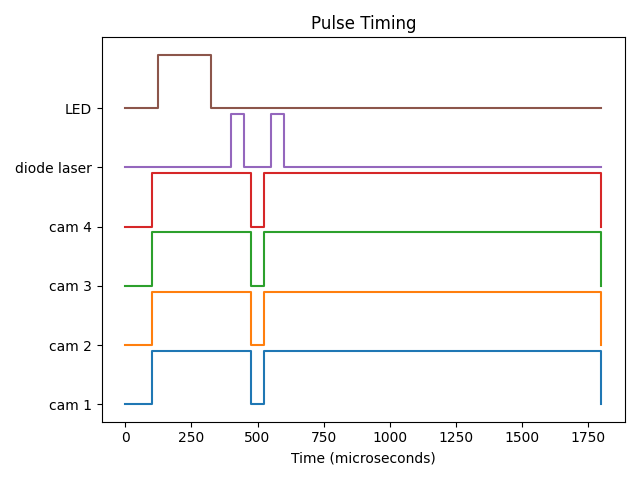
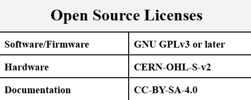

# OpenSync
An open source synchronizer for the velocimetry of fluids using a Raspberry Pi microcontroller.

## Purpose
OpenSync is a simple and low-cost synchronizer based on microcontroller technology. Due to the intrinsic nature of microcontrollers compared to more advanced devices (e.g., field programmable gate arrays), sub-cycle accuracy and complex features that are typical of commercial propietary devices are not implemented. However, OpenSync remains sufficiently flexible and provides enough support for most users' needs when performing a PIV experiment. This is because OpenSync is a digital delay/pulse generator capable of having each output channel individually programmed. In adition to an all-microcontroller platform and a custom PCB, OpenSync devices provides a low-cost means to deterministic control of laboratory equipment.

## Basic Specs
 - **System Frequency**: 250 MHz (4 ns resolution)
 - **Output Channels**: 8
 - **Input Channels**: 2
 - **I/O Channel Voltage**: 3.3V or 5V @ high impedance

For a more detailed specification, please read the [datasheet](documents/datasheet/opensync_datasheet_markdown.md).

## Documentation
The complete documentation for OpenSync can be seen [here](https://erichzimmer.github.io/OpenSync/). Instructions to construct and use OpenSync are referenced [here](https://erichzimmer.github.io/OpenSync/users_guide/index.html). User's interested in the development process of OpenSync are kindly refered to the [SDLC documentation](documents/SDLC/README.md). There is a lot of information on the development process including some quirks from the pico microcontroller platform. Issues during construction or operation can be raised via GitHub issues to spread awareness.

## Acknowledgments
OpenSync thanks Dr. Ivan Nepomnyashchikh and Professor Alex Liberzon for spearheading open source, open hardware equipment for the OpenPIV project. The [original OpenPIV discussion](https://groups.google.com/g/openpiv-users/c/xi7qt28IGEE) helped initiate this project. Cost effective commercial PIV systems from [Optolution](https://optolution.com/en/) provided a strong inspiration to complete this project. Additionally, certain hardware from [MicroVec Pte Ltd](https://piv.com.sg/) was used as inspiration in earlier prototypes.

## Responsible AI
The use of large language models (or LLMs) within this project is disclosed under the [Responsible AI Disclosure](RESPONSIBLE_AI.md).

## TODO
- [x] Add timing plot utilities
- [x] Add device containerization for customization
- [x] Add the ability to change channel names
- [x] Add the ability to disable output channels (necessary?)
- [x] Add three internal timers that can be mapped to pulse sequences
- [x] Add the ability to count and skip external triggers (usefull for phase-locked stuff like rotor blades)
- [x] Add second external trigger and output port masking
- [x] Update firmware and software to reflect new design
- [x] Get the damn production PCB produced
- [ ] Lower cost of PCB further (currently up to ~$100 USD per board)
- [ ] Validate new PCB against an osciliscope (mostly power planes; outputs seem okay)
- [ ] Add video examples on YouTube

## References
 1. Radim Hošák, & Miroslav Ježek. (2018). Arbitrary digital pulse sequence generator with delay-loop timing. Review of Scientific Instruments, 89(4). https://doi.org/10.1063/1.5019685
 2. Scallon, A. (2017, June 18). Arduino TTL Pulse Generator and Controller. Optogenetics and Neural Engineering Core. https://optogeneticsandneuralengineeringcore.gitlab.io/ONECoreSite/projects/Arduino%20TTL%20Pulse%20Generator%20and%20Controller/
 3. Starkey, P. T., Turnbaugh, C., Miller, P., LeBlanc, K.-J., & Meyer, D. H. (2024). Experimental timing and control using microcontrollers. Review of Scientific Instruments, 95(10). https://doi.org/10.1063/5.0225550
 4. Stasicki, B. and Ehrenfried, K. and Dieterle, L. and Ludwikowski, K. and Raffel, M.  (2001) Advanced syncronization techniques for complex flow field investigations by means of PIV .    4th Intern. Symposium on Particle Image Velocimetry, Göttingen, Germany, September 17-19, 2001.  
    
## Licensing

| Licenses | OSHWA UID |
| --- | --- |
|  | N/A |

- Software: All firmware and software components are covered by the GNU GPLv3 license.
- Hardware: All hardware is covered by the CERN-OHL-S-v2 license.
