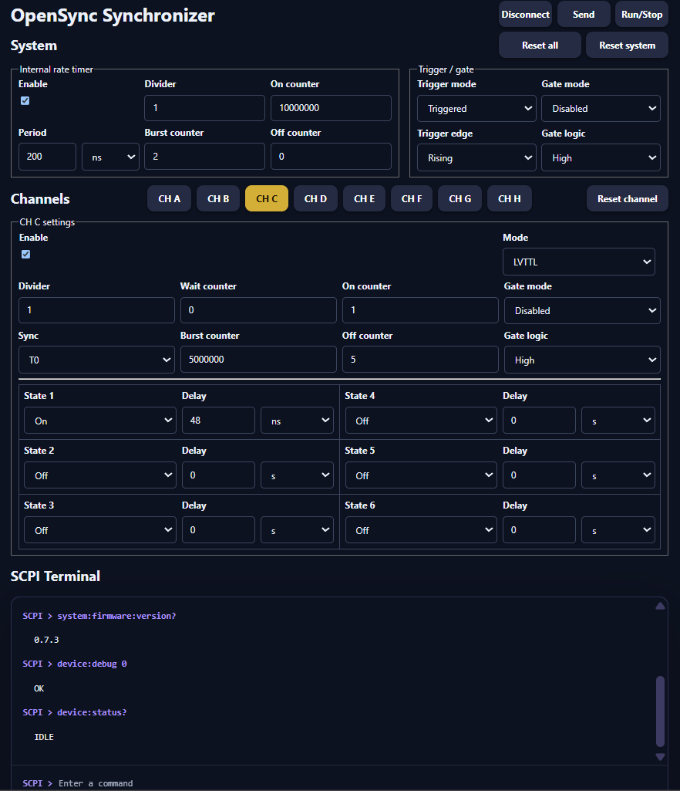

PWA
===

The OpenSync Synchronizer PWA groups the internal rate timer and trigger/gate
controls under **System**, with settings for outputs **CH A** through **CH H**
below.

   OpenSync Synchronizer PWA: system settings, output-channel controls,
   and the SCPI terminal.

Use the controls
----------------

* **Connect / Disconnect** opens or closes the USB serial connection. Select
  filtered port in the browser's serial-port selector when prompted.
* **System** sets the internal rate timer, its counters, and trigger/gate modes.
* **CH A--CH H** selects the output channel whose settings you are editing.
* **Send** uploads the system and channel settings to the device.
* **Run/Stop** queries device status and requests a start or stop.
* **Reset all**, **Reset system**, and **Reset channel** restore the respective
  settings in the editor. Use **Send** to apply edited settings to the device.
* **SCPI Terminal** sends individual commands and displays responses.

Settings are stored locally in the browser through DBOPFS. Editing or saving
browser settings is separate from sending them to the device. Close the serial
connection before switching control between the PWA and a Python session. Closing
the app also automatically closes the serial port in most cases through resource
management.

For installation steps, see :doc:`Install the PWA <../installation/pwa>`.
